<div align="center">


<br/>

<a href="https://mohit20678.github.io/campus-os/"></a>

<br/><br/>


**[The idea](#the-idea)** · **[Workflow](#the-workflow)** · **[See it think](#see-it-think)** · **[Features](#features)** · **[Architecture](#architecture)** · **[Security](#security-and-privacy)** · **[Roadmap](#roadmap)** · **[Run it](#run-it-yourself)**

</div>


## The idea

> Most college software tells you **what happened**.
> **CAMPUS OS tells you what is happening, why it is unusual, and what could happen next.**

A campus produces a huge amount of signal every day: people move, rooms fill and empty, energy is used, the same problems keep coming back. Today those signals live in separate places, so nobody can see the campus as one system.

CAMPUS OS is a **digital twin of the college**. It learns what *normal* looks like for every place and hour, flags what is not, remembers what happened, and lets administrators test decisions **before** spending any money.

| Traditional college systems | CAMPUS OS |
| --- | --- |
| Attendance records | Live campus activity |
| Complaint registers | Recurring problem patterns |
| Static reports | A live **Campus Pulse** score |
| Historical records | Comparison against a learned baseline |
| "What happened?" | **"What is unusual?"** |
| Fixed decisions | **"What if we change this?"** |

**Questions it is built to answer**

> Why is Block C packed at 1 PM? · How many rooms run with lights and AC on while empty? · Which problems keep repeating? · Is today normal for this hour? · What happens if we admit 1,000 more students?


## The workflow

<div align="center">
</div>

Every page in the product belongs to one of these five steps, and the sidebar is grouped the same way: **Observe**, **Understand**, **Decide**.


## See it think

<div align="center">
</div>

**Left:** how many students are on campus across a simulated weekday. **Right:** the library's *expected* crowd for that weekday and hour (dashed) against what is *observed* (solid). When observed climbs far above expected, the **Anomaly Radar** flags it, and suggests possible causes such as an exam period or an assignment deadline. Causes are suggestions, never claimed as facts.

Both curves come from the same engine as the live demo.

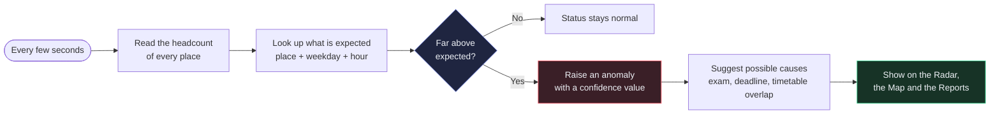

The sensitivity is adjustable in **Settings** (15% to 60% above expected; 30% by default).


## Campus Pulse

<div align="center">
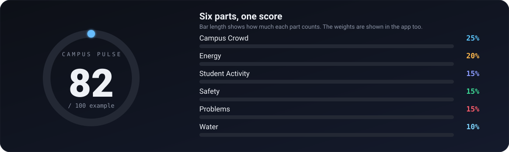
</div>

One number, 0 to 100, that says how the campus is doing right now. It is a **weighted average of six parts**, and the app shows the weights and the arithmetic, so nothing is hidden.

Every place is also classified as it fills up:

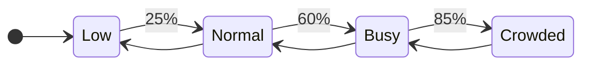


## Screenshots

<div align="center">

| Login | Dashboard |
| :---: | :---: |
| 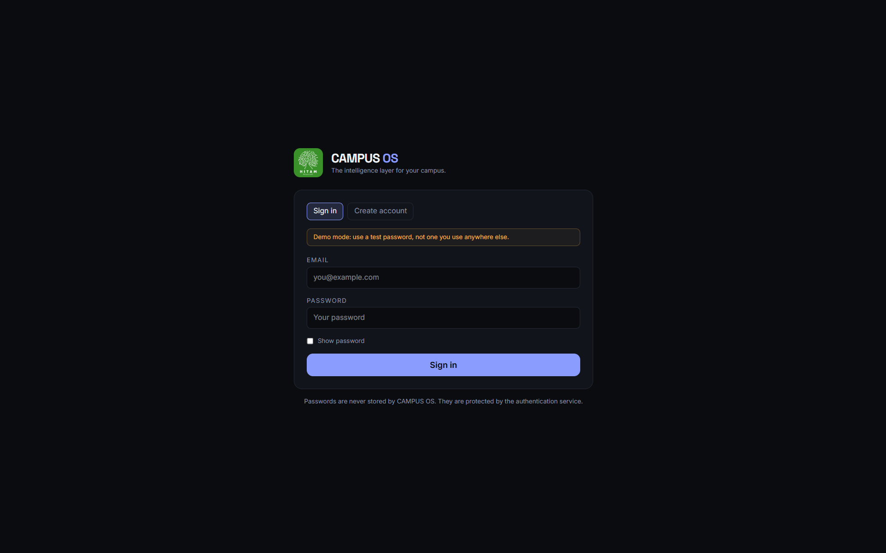 | 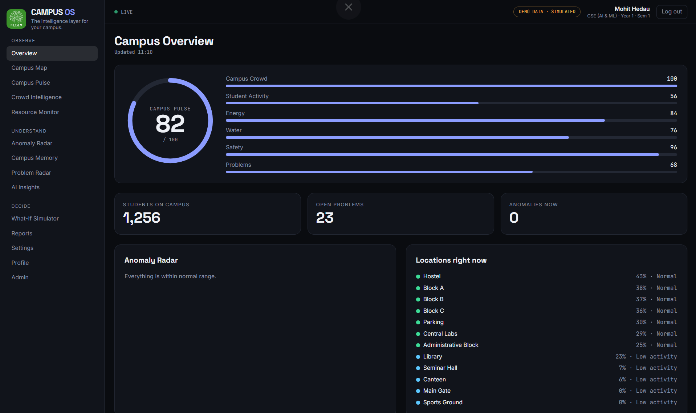 |

| Campus Map | What-If Simulator |
| :---: | :---: |
| 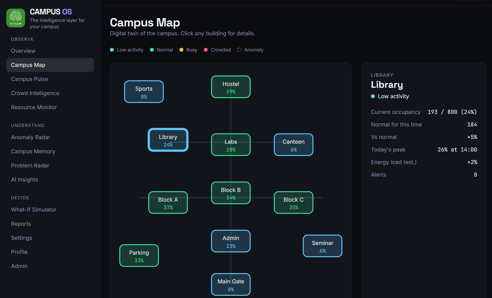 | 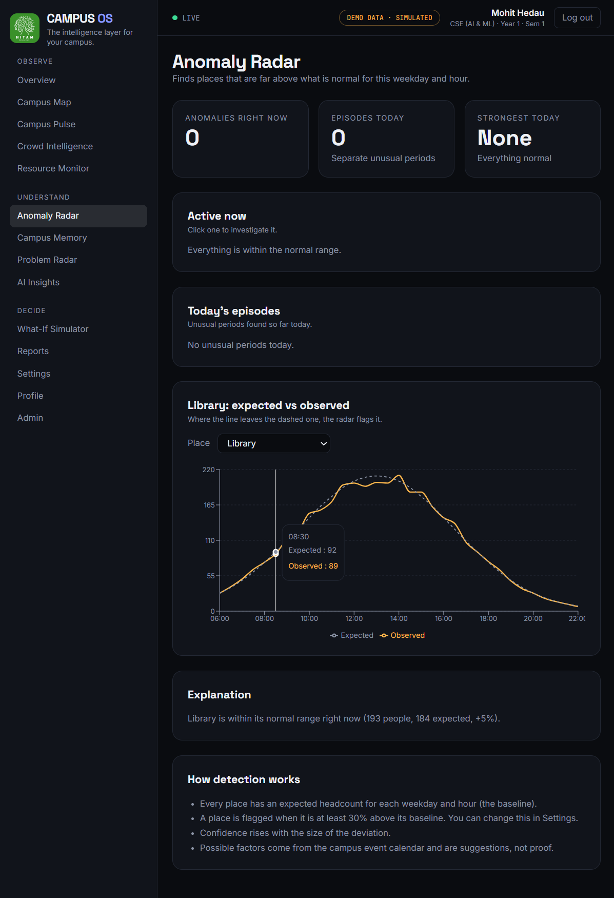 |

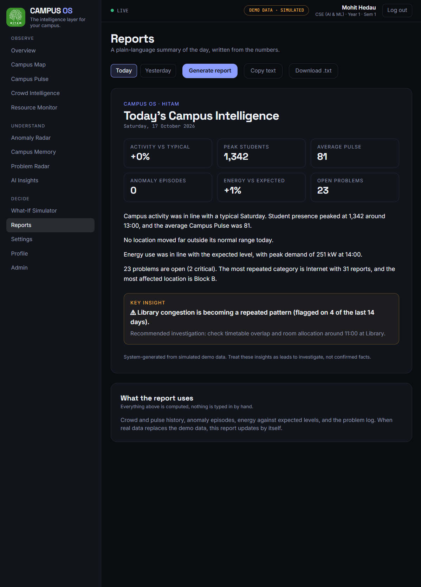

</div>


## Features

Every menu item is built and working. Campus data is **simulated** and clearly labelled in the app.

<details open>
<summary><b>🔭 Observe</b> · see the campus right now</summary>

<br/>

| Page | What it does |
| --- | --- |
| **Campus Overview** | Campus Pulse with six sub-scores, live stats, active anomalies, and every location sorted by crowd level. |
| **Campus Map** | An interactive digital-twin map of 12 locations. Click a building for occupancy, the normal level, today's peak and alerts. |
| **Campus Pulse** | Pulse and student-count charts through the day, plus a table that shows exactly how the score is built. |
| **Crowd Intelligence** | A heatmap of every place by hour. Click any cell for details. |
| **Resource Monitor** | Energy and water against the expected level, plus the **Waste Detective**: empty rooms with lights and AC left on. |

</details>

<details>
<summary><b>🧠 Understand</b> · find out why</summary>

<br/>

| Page | What it does |
| --- | --- |
| **Anomaly Radar** | Flags places far above their expected level, with an expected-vs-observed chart, a confidence value and possible causes. |
| **Campus Memory** | A timeline for today and yesterday, and charts for the week, month and semester. |
| **Problem Radar** | Complaints turned into patterns: filters, the most repeated issue, the most affected location and the average fix time. |
| **AI Insights** | Rule-based leads (repeated congestion, an energy gap, waste, recurring problems) with evidence, a recommended investigation and a confidence value. |

</details>

<details>
<summary><b>🎯 Decide</b> · act with evidence</summary>

<br/>

| Page | What it does |
| --- | --- |
| **What-If Simulator** | Change students, classrooms, canteens, parking, library seats and labs, then see the projected pressure. Every assumption is shown on the page. |
| **Reports** | A written daily report built from the numbers, with copy and download. |
| **Settings** | Anomaly sensitivity and refresh rate. |
| **Profile** | A role demonstration, and a student **Find a place** view: a quiet study space, the least crowded block, and the quietest time to eat. |
| **Admin** | Owner-only list of registered students with counts by branch and year, search, filters and CSV download. |

</details>

<details>
<summary><b>🔐 Accounts</b> · login and sign-up</summary>

<br/>

Students register with **name, class, branch, year, semester, email and password**. The whole site sits behind login, so a visitor lands on the login page first.

</details>


## Architecture

<div align="center">
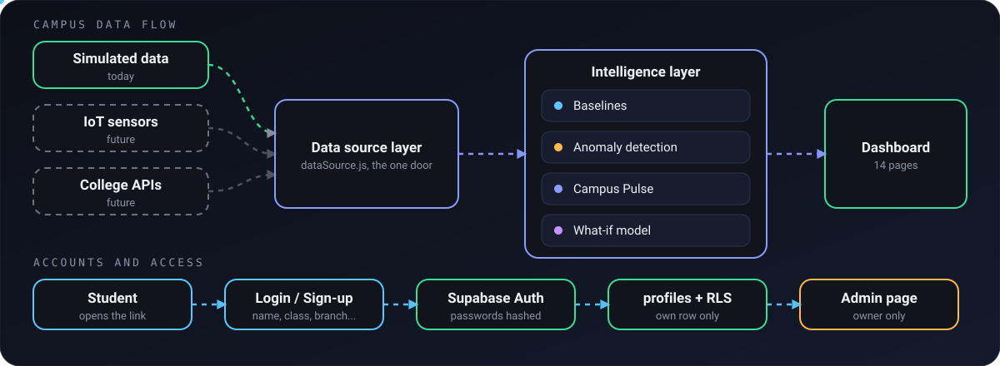
</div>

**The key design decision:** all campus data flows through one file, `src/data/dataSource.js`. When real sensors, college APIs or database tables replace the simulation, **only that file changes**. The dashboard and the intelligence layers stay as they are.

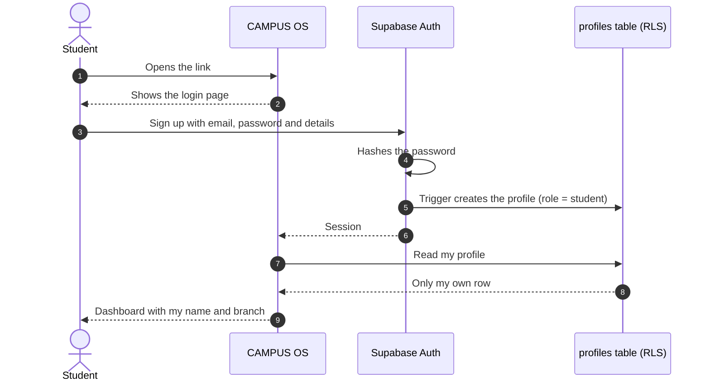


## Security and privacy

| | |
| --- | --- |
| ✅ **Campus data is aggregated** | Headcounts per zone. Individual students and their movements are never tracked. |
| ✅ **Passwords are not stored by this project** | Supabase Auth keeps only a hash. |
| ✅ **Row Level Security** | A student can read and edit only their own profile row, and only name, class, branch, year and semester. |
| ✅ **No self-promotion** | Nobody can change their own role from the website, so a student cannot become an admin. |
| ✅ **Owner-only admin** | The admin role is set by the project owner in the database and is the only one that can read every profile. |
| ✅ **Safe keys** | Only the public `anon` key is used in the site. The `service_role` key is never in the project, and `.env.local` is ignored by Git. |

> ### ⚠️ Demo mode
> To make demonstrations easy, **any email address can register** and email confirmation is switched off. Before real students use CAMPUS OS, the **college email domain will be enforced in the database** and **email verification will be turned on**.


## Roadmap

<div align="center">

</div>

- [x] Dashboard, Campus Pulse and Anomaly Radar
- [x] Interactive campus map and crowd heatmap
- [x] Campus Memory, Problem Radar, Resource Monitor and Waste Detective
- [x] What-If Simulator and daily report
- [x] Supabase login, Row Level Security and the admin page
- [ ] Enforce the college email domain and turn on email verification
- [ ] Connect real data: Wi-Fi access-point counts, energy and water meters, timetables
- [ ] A facility-manager role enforced in the database
- [ ] Rolling z-score and Isolation Forest for anomaly detection
- [ ] Seasonal forecasting
- [ ] LLM-written reports from computed statistics only
- [ ] PDF reports and a presentation mode

> **Honest status:** the intelligence today is simple, explainable rules. **No language model is used yet**, and nothing in a report is typed in by hand. Campus numbers come from a simulation and are labelled that way.


## Tech stack

<div align="center">


</div>

**Design system:** near-black graphite, one indigo accent, and green, amber, red and blue for status. Space Grotesk for headings, Inter for text, JetBrains Mono for numbers.

<details>
<summary><b>📁 Project structure</b></summary>

```text
campus-os/
├── public/
│   └── hitam-logo.png
├── docs/                      # README graphics and screenshots
├── src/
│   ├── components/
│   │   ├── Layout.jsx         # sidebar, top bar, log out
│   │   ├── PulseRing.jsx
│   │   ├── RequireAuth.jsx    # the login gate
│   │   └── ui.jsx             # shared building blocks
│   ├── data/
│   │   ├── buildings.js       # the 12 locations
│   │   ├── generator.js       # the simulated campus day
│   │   ├── dataSource.js      # the one door for campus data
│   │   ├── demo.js            # history, resources, problems
│   │   ├── analysis.js        # anomaly episodes, patterns, report
│   │   ├── simulator.js       # the What-If model
│   │   └── settings.js        # saved settings
│   ├── hooks/
│   │   └── useSnapshot.js
│   ├── lib/
│   │   ├── supabase.js
│   │   └── AuthContext.jsx    # session, profile, admin flag
│   ├── pages/                 # one file per menu item, plus Login
│   ├── nav.js
│   ├── App.jsx
│   ├── main.jsx
│   └── index.css
└── package.json
```

</details>


## Run it yourself

```bash
git clone https://github.com/mohit20678/campus-os.git
cd campus-os
npm install
```

Create a free project at [supabase.com](https://supabase.com), then add a file named `.env.local` in the project root:

```text
VITE_SUPABASE_URL=https://YOUR-PROJECT-ID.supabase.co
VITE_SUPABASE_ANON_KEY=YOUR-PUBLISHABLE-KEY
```

Use only the **publishable (anon)** key. Never put a secret or `service_role` key here.

In Supabase, switch **Authentication → Sign In / Providers → Email → Confirm email** off for demo use, then run the SQL below once in the **SQL Editor**.

<details>
<summary><b>🗄️ Database setup (SQL)</b></summary>

```sql
create table public.profiles (
  id uuid primary key references auth.users (id) on delete cascade,
  email text not null,
  full_name text not null,
  class_name text not null,
  branch text not null,
  year smallint not null check (year between 1 and 4),
  semester smallint not null check (semester between 1 and 8),
  role text not null default 'student' check (role in ('student', 'admin')),
  created_at timestamptz not null default now(),
  check (semester in (year * 2 - 1, year * 2))
);

alter table public.profiles enable row level security;
revoke all on public.profiles from anon, authenticated;

grant select on public.profiles to authenticated;
grant update (full_name, class_name, branch, year, semester) on public.profiles to authenticated;

create policy "Students read own profile"
  on public.profiles for select to authenticated
  using (id = (select auth.uid()));

create policy "Students update own profile"
  on public.profiles for update to authenticated
  using (id = (select auth.uid()))
  with check (id = (select auth.uid()));

create or replace function public.is_admin()
returns boolean language sql stable security definer set search_path = '' as $$
  select exists (
    select 1 from public.profiles
    where id = (select auth.uid()) and role = 'admin'
  );
$$;

revoke execute on function public.is_admin() from public, anon;
grant execute on function public.is_admin() to authenticated;

create policy "Admins read all profiles"
  on public.profiles for select to authenticated
  using (public.is_admin());

create or replace function public.handle_new_user()
returns trigger language plpgsql security definer set search_path = '' as $$
begin
  insert into public.profiles (id, email, full_name, class_name, branch, year, semester)
  values (
    new.id, new.email,
    coalesce(new.raw_user_meta_data ->> 'full_name', ''),
    coalesce(new.raw_user_meta_data ->> 'class_name', ''),
    coalesce(new.raw_user_meta_data ->> 'branch', ''),
    coalesce((new.raw_user_meta_data ->> 'year')::smallint, 1),
    coalesce((new.raw_user_meta_data ->> 'semester')::smallint, 1)
  );
  return new;
end;
$$;

create trigger on_auth_user_created
  after insert on auth.users
  for each row execute function public.handle_new_user();
```

To make an account the admin, run this in the SQL Editor:

```sql
update public.profiles set role = 'admin' where email = 'you@example.com';
```

</details>

Then start it:

```bash
npm run dev
```

Open `http://localhost:5173/campus-os/`. To publish your own copy, run `npm run deploy`.


<div align="center">

### Built by Mohit Yogesh Hedau

**CSE (AI + ML) · HITAM**

<a href="https://github.com/mohit20678"></a>
<a href="https://mohit20678.github.io/campus-os/"></a>

<br/><br/>

*“Find your path.”* · **HITAM**

**CAMPUS OS** · *making the campus observable, understandable, and eventually simulatable.*

<br/>

⭐ If the idea interests you, consider starring the repository.

</div>
